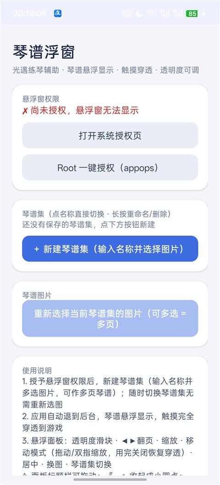
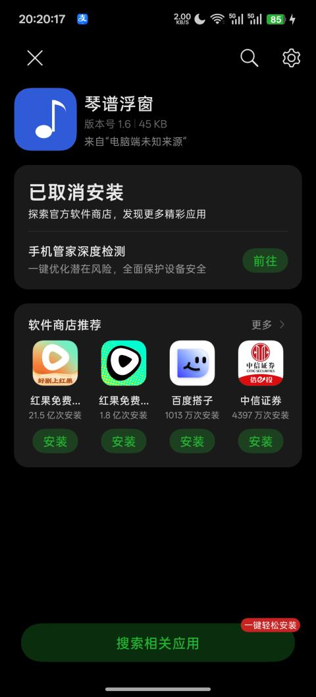

# 琴谱浮窗 · Android 版 (Qinpu Overlay)

> 作者：**Fc100700** · GitHub: [https://github.com/Fc100700](https://github.com/Fc100700)

光遇练琴辅助工具：把琴谱以悬浮窗显示在游戏上层，支持图片琴谱与格子谱，触摸完全穿透，边看谱边弹琴。完全离线，不申请网络权限。

## 功能

- 悬浮显示多页琴谱图片，可拖动、缩放、旋转
- 琴谱集管理：多套琴谱随时切换，每套独立记忆位置、尺寸与图像调节（亮度 / 对比度 / 伽马）
- 格子谱：导入文本按键序列，本机渲染为透明底谱面，可设行列、四色配色、单键 / 左右 / 上下组合布局
- 悬浮面板：不透明度、翻页、缩放、居中、换图、谱集切换、移动模式
- 触摸穿透：默认完全穿透，不影响游戏操作；Android 12+ 高不透明度阈值可用 Root 解锁
- 通知栏控制 + 快捷设置磁贴（琴谱浮窗）
- 适配 Android 8.0 – 16（含 ColorOS）与深色模式

## 截图

| 主界面 | 悬浮琴谱 |
| --- | --- |
|  |  |

## 构建

无需 Android Studio，纯命令行构建：

环境要求：

- JDK 8+（脚本按 `--release 8` 编译）
- Android SDK：build-tools 36.1.0、platform android-36

修改 `build.ps1` 顶部的 `$sdk` / `$jdk` 为你的本地路径，然后：

```powershell
.\build.ps1 -SkipSign   # 仅编译，输出未签名 APK 到 dist\
.\build.ps1             # 编译并签名，输出 dist\qinpu-1.8-release.apk
```

> 本仓库不包含正式签名密钥（`keystore/` 已列入 `.gitignore`）。若本地缺少 keystore，脚本会自动生成一个测试用密钥。

## 目录结构

```
AndroidManifest.xml      应用清单
build.ps1                命令行构建脚本（aapt2 + javac + d8 + zipalign + apksigner）
src/com/qinpu/overlay
  MainActivity.java      主界面：谱集管理、格子谱导入与样式设置
  OverlayService.java    悬浮窗服务：显示、触摸穿透、控制面板、通知
  GridScore.java         格子谱渲染
  SetStore.java          谱集数据持久化
  QinpuTileService.java  快捷设置磁贴
res/                     应用资源
tools/                   开发辅助脚本
```

## 使用说明

1. 安装 APK，授予悬浮窗权限
2. 新建琴谱集并选择图片（可多选 = 多页），或导入格子谱文本（格式如 `['1,4,10', '1', '3']`，编号 1~15，左上为 1）
3. 启动悬浮窗后回到游戏，琴谱悬浮显示并触摸穿透
4. 通过悬浮面板调整不透明度、翻页、缩放，需要拖动时开启「移动模式」

## 声明

- 本项目为个人兴趣爱好作品，仅供学习交流使用，与游戏官方无关。
- 请遵守游戏用户协议，使用风险自负。

## 作者

**Fc100700** · GitHub: [https://github.com/Fc100700](https://github.com/Fc100700)

## 许可证

[MIT License](LICENSE)
